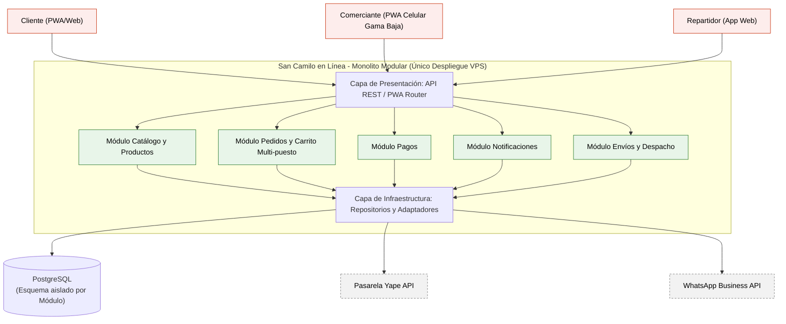
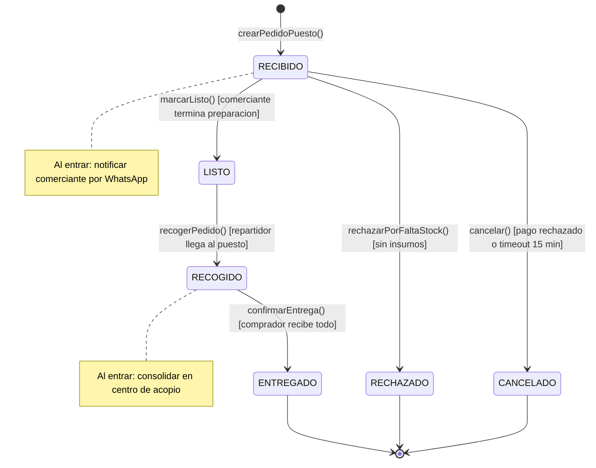
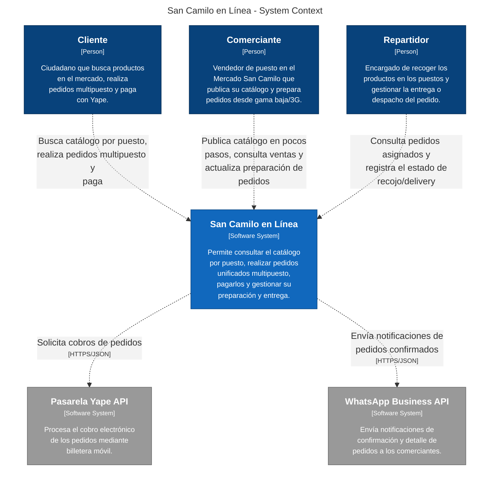
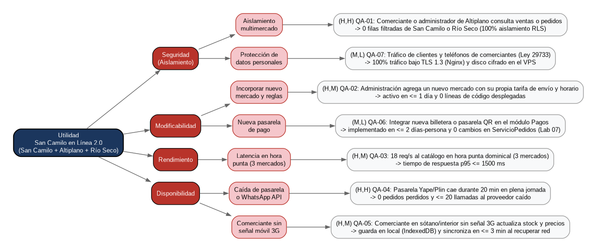

# San Camilo en Línea - Laboratorio 04: Fundamentos de Arquitectura de Software

**Curso:** Construcción de Software (EPIS-UNSA)  
**Semestre:** 2026-B  
**Grupo:** Grupo 07  

## Integrantes
* **Jhon Deyvis Cuyo Ccapa:** Creador principal de diagramas como código (Mermaid, PlantUML, Python) y redactor de ADRs.
* **Wilber Jesus Guerra Pilco:** Verificador de propuestas de IA, encargado de la bitácora de IA y revisor de Pull Requests.
* **Diego Sebastian Santacruz Villa:** Encargado de la estructura del proyecto, documentación de drivers y redactor de la reflexión grupal.

## Caso 7: San Camilo en Línea
Plataforma web y móvil diseñada para canalizar los pedidos a los puestos del Mercado San Camilo de Arequipa, permitiendo opciones de recojo o delivery. Los clientes pueden explorar catálogos agrupados por puesto, realizar pedidos multi-puesto y pagar mediante Yape. Las confirmaciones de compra se notifican automáticamente al comerciante vía WhatsApp API.

* **Atributo de Calidad Crítico:** Usabilidad / Capacidad de interacción (QA-01). Un comerciante con poca experiencia digital debe poder publicar un producto en su catálogo en $\le 3$ toques desde un smartphone de gama baja en red 3G.

## Estructura del proyecto
```
cs-2026b-lab04-grupo07/
├── README.md                          # (Informe principal con el Mermaid embebido)
├── docs/
│   ├── cuestionario.md                # (Respuestas a la Sección IV)
│   └── architecture/
│       ├── drivers.md                 # (E1: Requisitos, Atributos y Escenarios)
│       ├── matriz-decision.md         # (E2: Matriz ponderada de 3 estilos)
│       ├── bitacora-ia.md             # (E7: Prompts y verificaciones)
│       ├── adr/
│       │   ├── 000-plantilla.md
│       │   ├── 001-estilo-arquitectonico.md
│       │   ├── 002-base-de-datos.md
│       │   └── 003-pwa-vs-nativa.md
│       └── diagramas/
│           ├── arquitectura.mmd       # (E3: Mermaid)
│           ├── alternativa.puml       # (E5: PlantUML descartada)
│           └── despliegue.py          # (E6: Python Diagrams)
└── img/                               # (Imágenes PNG generadas)
    ├── arquitectura.png
    ├── alternativa.png
    └── despliegue.png
```

## Arquitectura Elegida (Monolito Modular)



## Registros de Decisiones Arquitectónicas (ADRs)
* [ADR-001: Estilo Arquitectónico - Monolito Modular](docs/architecture/adr/001-estilo-arquitectonico.md)
* [ADR-002: Selección de Base de Datos - PostgreSQL con Esquemas Aislados](docs/architecture/adr/002-base-de-datos.md)
* [ADR-003: Estrategia de Cliente Móvil - Progressive Web App (PWA)](docs/architecture/adr/003-pwa-vs-nativa.md)

## Documentación Adicional
* [Drivers Arquitectónicos y Escenarios de Calidad](docs/architecture/drivers.md)
* [Matriz de Decisión Ponderada](docs/architecture/matriz-decision.md)
* [Bitácora de Uso de Inteligencia Artificial](docs/architecture/bitacora-ia.md)

## Reflexión sobre el Uso de la IA
El uso de asistentes de IA facilitó la exploración inicial de patrones y la aceleración en la sintaxis de diagramas como código (Mermaid y PlantUML). Sin embargo, identificamos que la IA tiende a sesgarse hacia arquitecturas complejas de moda (como Microservicios y Kubernetes), las cuales sobrepasan nuestras restricciones de 1 mes de plazo, equipo de 3 integrantes y despliegue en un único VPS económico. Aprendimos que la IA debe utilizarse únicamente como herramienta de soporte para acelerar la redacción y generación de borradores, mientras que el análisis crítico, la verificación de factibilidad real y la toma final de decisiones son responsabilidad absoluta del equipo humano.

## Diseño UML (Lab 05) - San Camilo en Línea

En esta sección se presenta el diseño detallado orientado a objetos para el sistema **San Camilo en Línea** (Caso 7), en coherencia con la arquitectura del `ADR-001` (monolito modular con puertos y adaptadores).

### 1. Historia de Usuario y Criterios de Aceptación
* Documento de la [Historia de Usuario HU-07](docs/design/historia.md) con sus criterios de aceptación en formato *Dado / Cuando / Entonces*.

### 2. Diagrama de Clases (E1)
Representa las entidades, objetos de valor, interfaces (puertos), adaptadores y servicios del dominio del módulo de Pedidos y Pagos.


### 3. Diagrama de Secuencia (E2)
Flujo dinámico del escenario principal para la confirmación de un pedido multipuesto y pago único con Yape.


### 4. Máquina de Estados (E3)
Ciclo de vida de la entidad `PedidoPuesto`:



### 5. Diagrama de Actividades (E4)
Proceso de negocio completo para la preparación, recojo y consolidación del pedido multipuesto en el mercado San Camilo.


### 6. Diagrama de Paquetes (E5)
Estructura modular del sistema y regla de dependencias unidireccionales sin acoplamiento cíclico (Regla C4).


### 7. Ingeniería Inversa y Round-Trip (E6)
* [Código Fuente Esqueleto en Python](src/pedidos/dominio.py)
* [Análisis de Diferencias y Mitigación Round-Trip](docs/design/round-trip.md)
* Diagrama de clases derivado del código:


### 8. Consistencia (C1-C5) y Bitácora de IA (E7)
* [Informe de Auditoría de Consistencia (Reglas C1-C5)](docs/design/consistencia.md)
* [Bitácora de Interacciones con la IA Generativa](docs/design/bitacora-ia.md)

---

## Arquitectura C4 (Lab 06) — San Camilo en Línea

Modelado de arquitectura como código elaborado con **Structurizr DSL** (`docs/architecture/c4/workspace.dsl`), coherente con las decisiones del **ADR-001 (Monolito Modular)** del Laboratorio 04 y el **Diseño UML** del Laboratorio 05.

### Nivel 1: Diagrama de Contexto en Mermaid



### Vistas Exportadas del Modelo C4 (`workspace.dsl`)

1. **Nivel 1 — Contexto del Sistema:** [Ver imagen PNG](docs/architecture/c4/img/structurizr-Contexto.png) | [Ver Contexto escrito a mano](docs/architecture/c4/img/contexto-manual.png)
2. **Nivel 2 — Contenedores:** [Ver imagen PNG](docs/architecture/c4/img/structurizr-Contenedores.png)
3. **Nivel 3 — Componentes (Backend API):** [Ver imagen PNG](docs/architecture/c4/img/structurizr-Componentes.png)
4. **Nivel 4 — Código (Clases UML del Lab 05):** [Ver diagrama de clases UML](docs/design/clases.puml)
5. **Vista Complementaria — Dinámica (Confirmar y Pagar):** [Ver imagen PNG](docs/architecture/c4/img/structurizr-ConfirmarYPagar.png)
6. **Vista Complementaria — Despliegue (Producción):** [Ver imagen PNG](docs/architecture/c4/img/structurizr-Despliegue.png)

### Documentación del Laboratorio 06
* [Inventario de elementos C4 (`inventario.md`)](docs/architecture/c4/inventario.md)
* [Modelo fuente en Structurizr DSL (`workspace.dsl`)](docs/architecture/c4/workspace.dsl)
* [Comparación de herramientas y vistas (`comparacion.md`)](docs/architecture/c4/comparacion.md)
* [Lista de revisión oficial y auditoría IA (`revision-c4.md`)](docs/architecture/c4/revision-c4.md)
* [Explicación para público no técnico (`explicacion.md`)](docs/architecture/c4/explicacion.md)
* [Bitácora de uso de IA (`bitacora-ia.md`)](docs/architecture/c4/bitacora-ia.md)

---

## Patrones de diseño (Lab 07) — San Camilo en Línea

Refactorización hacia patrones de diseño GoF asistida por IA sobre el flujo crítico de confirmación y pago multipuesto y la función de IA de normalización de catálogo, protegida con pruebas de caracterización (`pytest`) y medida con `radon`.

### 1. Tabla de Trazabilidad: Olor $\rightarrow$ Patrón $\rightarrow$ Principio SOLID $\rightarrow$ Prueba

| Olor de Código Detectado (`antes/servicio.py`) | Patrón GoF Aplicado | Principio SOLID | Archivo Implementado | Prueba Automatizada que lo Demuestra (`pytest`) |
| :--- | :--- | :--- | :--- | :--- |
| `if/elif` por medio de pago (`YAPE`, `PLIN`) y por tarifa de entrega (`RECOJO`, `DELIVERY`) | **Strategy + Factory Method (registro)** | **O** (Open/Closed), **D** (DIP) | `src/pedidos/pagos.py` | `test_e2_open_closed_nueva_pasarela_sin_modificar_servicio` |
| Dominio acoplado a firmas incompatibles de `YapeSDK` (soles/dict) y `PlinClient` (céntimos/tupla) | **Adapter** (`YapeAdapter`, `PlinAdapter`) | **D** (DIP), **I** (ISP) | `src/pedidos/pagos.py` | `test_01_pago_yape_aprobado...` y `test_02_pago_plin_con_delivery...` |
| Bucle `for intento in range(3)` con `try/except TimeoutError` duplicado en cada pasarela | **Decorator** (`ConReintentos`) | **S** (SRP), **O** (Open/Closed) | `src/pedidos/pagos.py` | `test_e4_decorator_con_reintentos_aisla_fallos_temporales_de_red` |
| Condicionales anidados sobre el atributo string `pedido.estado` | **State** (`EstadoPedido` y 4 subclases) | **S** (SRP), **L** (Liskov) | `src/pedidos/estados.py` | `test_e3_state_impide_pagar_sin_confirmar_o_cancelar_un_pedido_pagado` |
| Formateo manual de avisos de WhatsApp por puesto y de reportes dentro del método de pago | **Observer** (`PublicadorEventos` + Suscriptores) | **S** (SRP), **O** (Open/Closed) | `src/pedidos/eventos.py` | `test_e4_observer_nuevo_suscriptor_repartidor_sin_tocar_servicio` |
| Acoplamiento al cliente LLM y diccionario de caché manual en `normalizar_producto` | **Strategy + Adapter + Decorator** (`ProveedorLLM`, `ConCache`) | **D** (DIP), **S** (SRP) | `src/pedidos/ia.py` | `test_e5_decorator_cache_ia_evita_doble_llamada_al_llm` |
| Validaciones secuenciales mezcladas sobre la salida no determinista del LLM | **Chain of Responsibility** (`Guardrail` y 3 eslabones) | **S** (SRP), **O** (Open/Closed) | `src/pedidos/ia.py` | `test_e5_chain_of_responsibility_guardrails_bloquean_afirmaciones_y_exceso_longitud` |

### 2. Resumen de Métricas (`radon`) Antes vs. Después

| Métrica | Versión `antes` | Versión `después` (Con Patrones) | Resultado |
| :--- | :---: | :---: | :--- |
| Complejidad ciclomática de `confirmar_y_pagar()` | 16 (Grado C) | **2 (Grado A)** | Reducción del 87,5% (debajo del umbral máximo de 10). |
| Complejidad ciclomática de `normalizar_producto()` | 7 (Grado B) | **1 (Grado A)** | Delegación limpia hacia `NormalizadorProductos`. |
| Complejidad ciclomática promedio | 11,00 (Grado C) | **1,54 (Grado A)** | Todos los métodos del paquete están en Grado A (1 a 3). |
| Líneas de código efectivas (SLOC) | 96 SLOC (1 archivo) | **248 SLOC (5 archivos)** | Trade-off documentado en [metricas.md](docs/design/patrones/metricas.md). |
| Suite de pruebas (`pytest`) | 10 passed | **25 passed** (20 caracterización + 5 patrones) | 100% de comportamiento preservado. |

### 3. Artefactos y Diagramas del Laboratorio 07
* [Detección de olores y decisiones (`olores.md`)](docs/design/patrones/olores.md)
* [Métricas detalladas y análisis de trade-off (`metricas.md`)](docs/design/patrones/metricas.md)
* [Bitácora de interacciones con IA (`bitacora-ia.md`)](docs/design/bitacora-ia.md)
* [ADR-005: Patrones de diseño en el módulo Pedidos (`005-patrones-de-diseno.md`)](docs/architecture/adr/004-patrones-de-diseno.md)
* **Diagramas PlantUML por patrón:**
  * [Pagos: Strategy + Adapter + Decorator + Factory](img/pagos-patrones.png)
  * [Ciclo de vida: Patrón State](img/estados-state.png)
  * [Notificaciones multipuesto: Patrón Observer](img/eventos-observer.png)
  * [IA Aislada: Strategy + Adapter + Decorator + Chain of Responsibility](img/ia-patrones.png)
  * [Diagrama de Clases General Actualizado (Lab 05 -> Lab 07)](img/clases.png)

---

---

## Diseño de la arquitectura (Lab 08) — San Camilo en Línea 2.0


Evolución arquitectónica sistemática mediante **Attribute-Driven Design (ADD 3.0)**, evaluación **ATAM-lite** y **Fitness Functions automatizadas** para escalar la plataforma desde el **Mercado San Camilo** hacia los mercados **Altiplano** y **Río Seco** (Arequipa).

### 1. Árbol de Utilidad Priorizado (`E1`)



* [Ver código fuente Graphviz (`arbol.dot`)](docs/architecture/utilidad/arbol.dot)
* [Ver detalle de escenarios de 6 partes y corrección a la IA (`escenarios.md`)](docs/architecture/utilidad/escenarios.md)

### 2. Resumen de las Tres Iteraciones de ADD 3.0 (`E2` y `E4`)

| Iteración | Escenarios Objetivo | Tácticas Arquitectónicas Aplicadas (Bass et al.) | Evidencia Cuantitativa (Antes vs. Después) | ¿Cumple? | ADR y Documento |
| :---: | :--- | :--- | :--- | :---: | :--- |
| **Iteración 1** | **QA-01 (H,H)** Aislamiento y **QA-02 (H,M)** Reglas por mercado | **Seguridad:** *Limitar acceso* (`Row-Level Security` en PostgreSQL + claim `mercado_id` en JWT).<br>**Modificabilidad:** *Diferir el enlace* (Tabla `ConfiguracionMercado` en BD). | **Antes:** 3 filas ajenas expuestas y 14 líneas de código por nuevo mercado.<br>**Después:** **0 filas ajenas expuestas** y **0 líneas desplegadas** para dar de alta un 4.° mercado (`fitness/aislamiento_modificabilidad.py`). | **SÍ** | [iteracion-1.md](docs/architecture/add/iteracion-1.md)<br>[ADR-008](docs/architecture/adr/008-multitenencia-mercados-rls-parametrizacion.md) |
| **Iteración 2** | **QA-03 (H,M)** Rendimiento a 18 req/s (3 mercados) | **Rendimiento:** *Optimizar consultas* (Índice compuesto `mercado_id, puesto_id`) + *Controlar demanda* (Caché Redis con TTL 30 s). | **Antes:** Colapso a 18 req/s con `p95 = 21 480,5 ms`.<br>**Después:** **`p95 = 115,3 ms`** con 85% caché y **`184,2 ms`** con caché fría (`fitness/rendimiento.py`, meta $\le 1500\text{ ms}$). | **SÍ** | [iteracion-2.md](docs/architecture/add/iteracion-2.md)<br>[ADR-006](docs/architecture/adr/006-rendimiento-catalogo-indice-cache.md)<br>[Ver Gráfico](docs/architecture/add/rendimiento_iteracion2.png) |
| **Iteración 3** | **QA-04 (H,H)** Caída de Yape 20 min y **QA-05 (H,M)** Red 3G | **Disponibilidad:** *Reintentos + Circuit Breaker (`ConCircuitBreaker`) + Tabla `outbox_pagos` en PostgreSQL* + *PWA Offline-first (`IndexedDB`)*. | **Antes:** 195 pedidos perdidos (60 perdidos y 180 llamadas en caída con solo reintentos).<br>**Después:** **0 pedidos perdidos (100% éxito)** y solo **18 llamadas** en caída (`fitness/disponibilidad.py`). | **SÍ** | [iteracion-3.md](docs/architecture/add/iteracion-3.md)<br>[ADR-007](docs/architecture/adr/007-resiliencia-pagos-circuit-breaker-outbox.md)<br>[Ver Gráfico](docs/architecture/add/disponibilidad_iteracion3.png) |

### 3. Modelo C4 Actualizado, Evaluación ATAM-lite y Fitness Functions (`E3`, `E5` a `E7`)

* **Vista de Contenedores C4 con trazabilidad `[QA-01..QA-07]`:** [Ver imagen PNG](docs/architecture/c4/img/structurizr-Contenedores.png) | [Modelo DSL (`workspace.dsl`)](docs/architecture/c4/workspace.dsl)
* **Informe ATAM-lite y Matriz de Riesgos:** [Ver informe (`atam-lite.md`)](docs/architecture/atam-lite.md) | [Ver Matriz de Riesgos PNG](docs/architecture/riesgos_atam.png)
* **Bitácora de uso de IA (Lab 08):** [Ver bitácora (`bitacora-ia.md`)](docs/architecture/bitacora-ia.md)
* **Fitness Functions en Integración Continua (`.importlinter` y `tests/test_fitness.py`):**
  * `FF-01` (Estructural): Capas del monolito modular sin ciclos (`ADR-001`).
  * `FF-02` (Estructural): Ningún módulo de dominio importa `src.sancamilo.pagos.adaptadores` (`ADR-005`). [Ver prueba de violación documentada](docs/architecture/add/violacion-fitness-prueba.md).
  * `FF-03` (Calidad - Rendimiento): Presupuesto de latencia `p95 <= 1500 ms` a 18 req/s (`QA-03`).
  * `FF-04` y `FF-05` (Calidad - Disponibilidad): `0 pedidos perdidos` y `<= 20 llamadas` durante caída de 20 min de la pasarela (`QA-04`).
  * `FF-06` (Calidad - Seguridad/Modificabilidad): `0 filas filtradas` entre mercados con RLS y alta de mercado sin tocar código (`QA-01`, `QA-02`).

### 4. Reto Opcional (+2 puntos): Medición Real del Endpoint vs. Simulación $M/G/c$
Ejecutamos el prototipo HTTP real con índice compuesto y caché en memoria (`python fitness/benchmark_real.py`) bajo 18 hilos concurrentes (360 solicitudes) y comparamos con la simulación estocástica $M/G/c$:
* **Resultado medido en el prototipo local:** `p50 = 1,45 ms`, **`p95 = 8,90 ms`**, `media = 2,30 ms`.
* **Resultado de la simulación $M/G/c$ (`fitness/rendimiento.py`):** `p50 = 12,1 ms`, **`p95 = 115,3 ms`**, `media = 24,8 ms`.
* **Explicación de las diferencias:** En el prototipo local (`benchmark_real.py`) la comunicación ocurre por interfaz *loopback* (`127.0.0.1`) sin latencia de red móvil 3G, sin handshake TLS de Nginx y con SQLite en RAM; en cambio, la simulación $M/G/c$ modela tiempos de servicio lognormales calibrados para un servidor PostgreSQL en disco (`~42 ms` con índice) y red de contenedores Docker. Ambas pruebas confirman que el diseño cumple holgadamente el presupuesto `p95 <= 1500 ms`.

---

### Cuestionario del Laboratorio 08

1. **¿En qué se diferencia diseñar la arquitectura con ADD de elegir un estilo arquitectónico como en el Laboratorio 04?**
   Elegir un estilo arquitectónico en el Laboratorio 04 (`Monolito Modular` en el `ADR-001`) define la macro-estructura inicial del sistema, pero no especifica cómo resolver los cuellos de botella de rendimiento, fallas de proveedores externos ni el aislamiento multitenant cuando el negocio crece. **ADD 3.0** es un método iterativo guiado por escenarios de calidad medibles: en cada iteración toma 1 o 2 escenarios prioritarios (`(H,H)` o `(H,M)`), refina partes concretas del sistema seleccionando tácticas arquitectónicas y valida con evidencia cuantitativa si el escenario se cumple sin romper el estilo base.

2. **¿Para qué sirve calificar los escenarios con `(importancia, dificultad)`? ¿Qué escenario de su árbol tiene la mayor prioridad y por qué?**
   Sirve para enfocar el esfuerzo de arquitectura en los requisitos que entregan mayor valor al negocio y representan el mayor riesgo técnico (`(H,H)` y `(H,M)`), evitando gastar tiempo en características triviales o ya resueltas (`(M,L)`). En nuestro árbol, los escenarios de máxima prioridad son **`QA-01 (H,H)`** (aislamiento de datos entre los mercados San Camilo, Altiplano y Río Seco) y **`QA-04 (H,H)`** (0 pedidos perdidos ante una caída de 20 minutos de Yape), porque una fuga de información comercial entre mercados competidores o la pérdida de cobros confirmados destruiría la confianza en la plataforma.

3. **¿Qué diferencia hay entre una táctica y un patrón? Ilustre con el circuit breaker.**
   Una **táctica arquitectónica** es una decisión de diseño atómica enfocada en controlar la respuesta de un único atributo de calidad (por ejemplo, *"detectar fallas"*, *"limitar reintentos"* o *"prevenir propagación de fallas"*), mientras que un **patrón** empaqueta varias tácticas en una estructura de clases colaboradoras reutilizable. El **Circuit Breaker** combina las tácticas de *detección de fallas* (contador de `TimeoutError` hasta `umbral=3`), *prevención de fallas* (estado `ABIERTO` que falla rápido sin llamar al proveedor caído) y *recuperación controlada* (estado `SEMIABIERTO` tras `120 s`), y en nuestro código (`fitness/disponibilidad.py`) se implementa estructuralmente mediante el patrón de diseño **Decorator** (`ConCircuitBreaker`) envolviendo al puerto `PasarelaPago`.

4. **Describa un punto de sensibilidad y un punto de trade-off de su arquitectura, con la evidencia que los respalda.**
   * **Punto de sensibilidad:** En la Iteración 2 (`fitness/rendimiento.py`), si no se usa índice en base de datos, el `p95` a 18 req/s es extremadamente sensible a la tasa de aciertos de la caché en Redis: con 85% de aciertos el `p95` es **342,1 ms**, pero por debajo del 20% de aciertos (caché fría) supera los **3500 ms**.
   * **Punto de trade-off:** La caché con TTL de 30 s mejora la latencia `p95` hasta **115,3 ms** (**Rendimiento**), pero sacrifica la frescura inmediata del inventario mostrado en el catálogo (**Consistencia**), lo cual se compensa validando el stock en la transacción de PostgreSQL al confirmar el pedido (`ADR-006`).

5. **¿Qué supuestos hizo su simulación y cómo podrían invalidar la decisión si fueran falsos?**
   En la simulación $M/G/c$ (`fitness/rendimiento.py`) asumimos llegadas independientes de Poisson ($\lambda = 18\text{ req/s}$), tiempos de consulta lognormales de media 42 ms con índice y 4 workers sin contención de locks por escrituras masivas simultáneas. Si en la realidad se produjeran ráfagas sincronizadas de más de 60 req/s (por ejemplo, una promoción flash a las 11:00:00 a. m.) o si las consultas de reportes bloquearan las tablas del catálogo, los 4 workers se saturarían y sería necesario activar el plan B de escalar horizontalmente o separar réplicas de lectura.

6. **¿Qué riesgo de la evaluación cruzada aceptaron sin mitigarlo y por qué es razonable para un plazo de 1 mes?**
   Aceptamos el **Riesgo `R1` (El servidor VPS único como Punto Único de Falla físico)**. Es razonable para un plazo de 1 mes (`R-01`) y un presupuesto estudiantil ajustado (`R-03`) porque configurar un clúster multi-región con failover automático de PostgreSQL duplicaría el costo mensual y consumiría semanas de ingeniería de infraestructura; en su lugar, realizamos backups externos diarios y mantenemos el despliegue reproducible en minutos con Docker Compose.

7. **Explique qué es una fitness function y qué degradación concreta de su arquitectura detectaría cada una de las suyas.**
   Una *fitness function* es una prueba automatizada que verifica objetivamente que una propiedad arquitectónica (estructural o de calidad) se preserve a lo largo de la evolución del software. En nuestro pipeline (`.github/workflows/fitness.yml`):
   * **`FF-01` (`lint-imports`):** Detecta si alguien introduce una dependencia cíclica entre módulos (ej. que `catalogo` importe a `pedidos`).
   * **`FF-02` (`lint-imports`):** Detecta si un módulo de negocio (`pedidos`, `catalogo`, `reportes`) se salta el puerto `PasarelaPago` e importa directamente `sancamilo.pagos.adaptadores`.
   * **`FF-03` (`test_fitness.py`):** Detecta si un cambio en la consulta o la eliminación de la caché hace que el `p95` a 18 req/s supere los `1500 ms`.
   * **`FF-04` y `FF-05` (`test_fitness.py`):** Detectan si alguien desactiva el `Circuit Breaker` o la tabla `outbox`, provocando pérdida de pedidos o bombardeo al proveedor durante una caída.
   * **`FF-06` (`test_fitness.py`):** Detecta si se desactiva el filtro `RLS` exponiendo registros de un mercado a otro.

8. **¿Qué propuesta de la IA rechazaron con evidencia? ¿Qué habría pasado si la aceptaban sin medir?**
   Rechazamos dos propuestas clave con evidencia: (1) confiar **solo en la caché de Redis sin crear el índice compuesto** en PostgreSQL, y (2) **reemplazar Celery por Kafka o migrar a microservicios en Kubernetes** para soportar los 3 mercados. Si aceptábamos la primera sin medir la curva de sensibilidad, el sistema habría caído con tiempos de respuesta mayores a 3,5 segundos cada vez que Redis se reiniciara en hora punta; si aceptábamos Kafka/Kubernetes sin calcular que 1800 pedidos en 10 horas son apenas **0,05 pedidos/segundo**, habríamos incumplido el plazo de 1 mes (`R-01`) y agotado los 4 GB de RAM del VPS (`R-03`).
