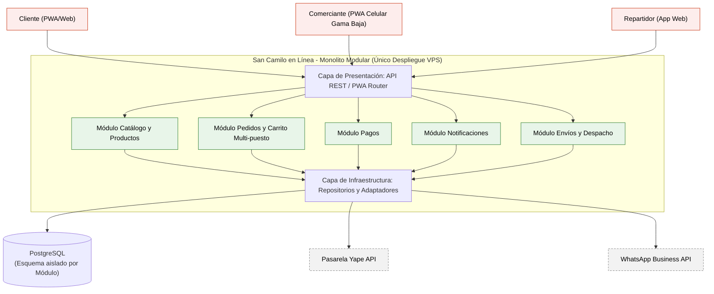
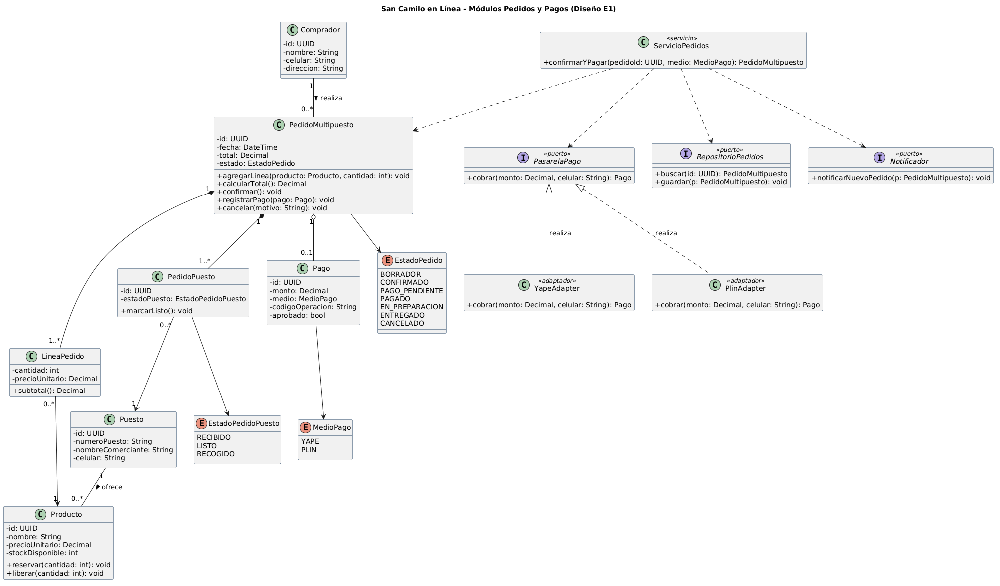
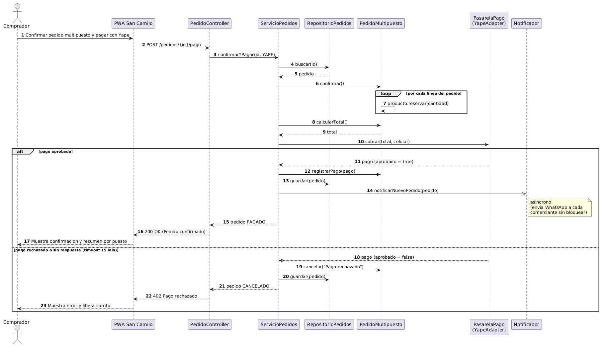
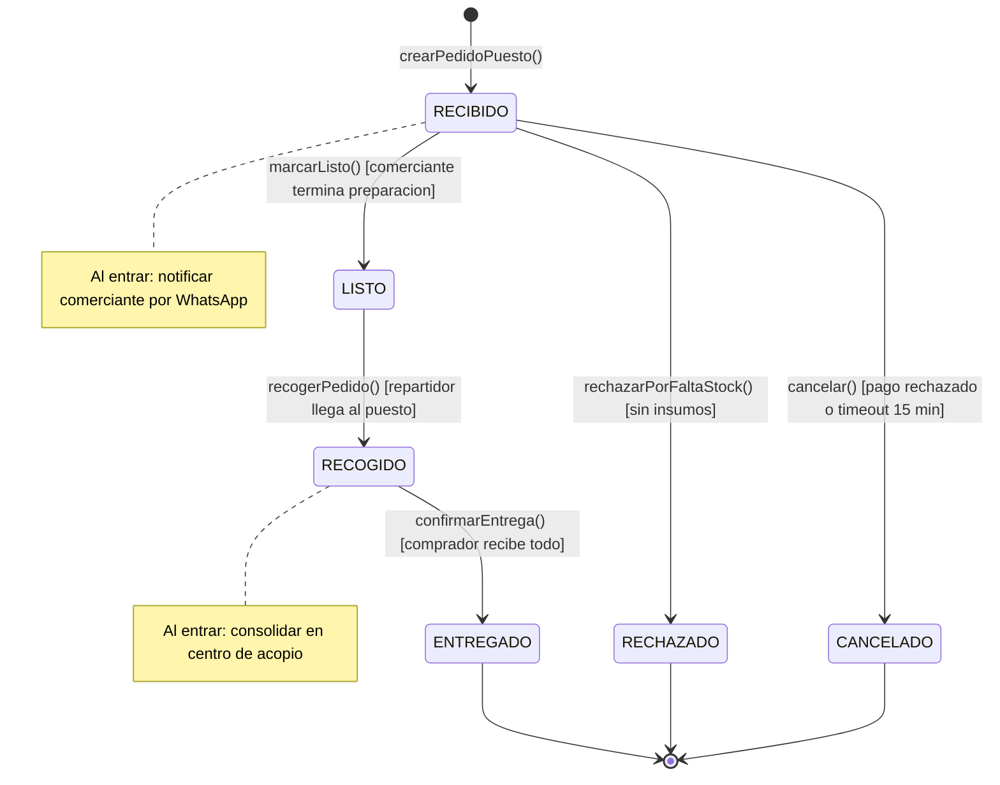
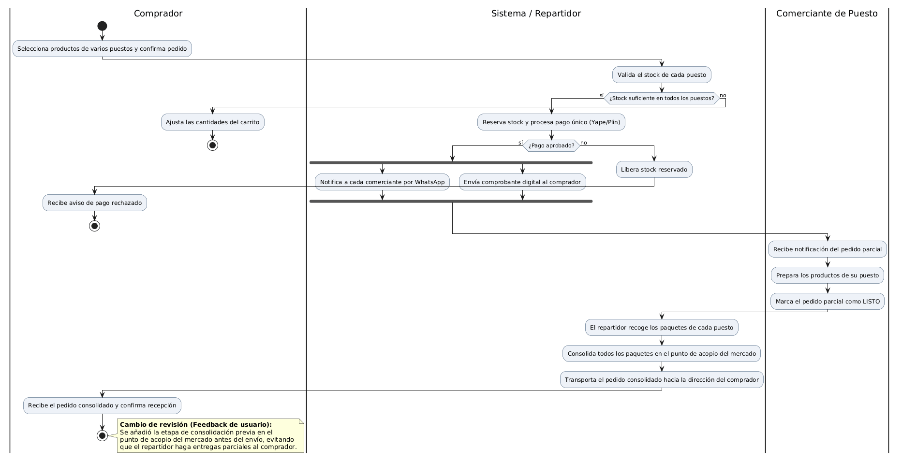
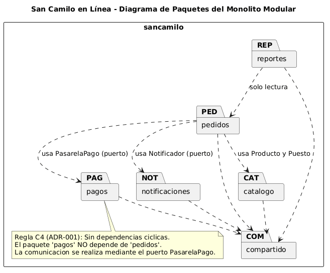
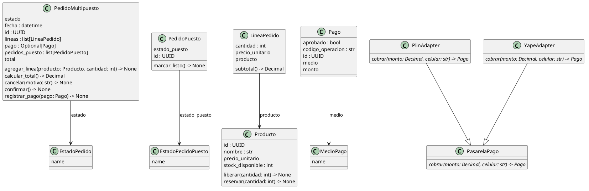
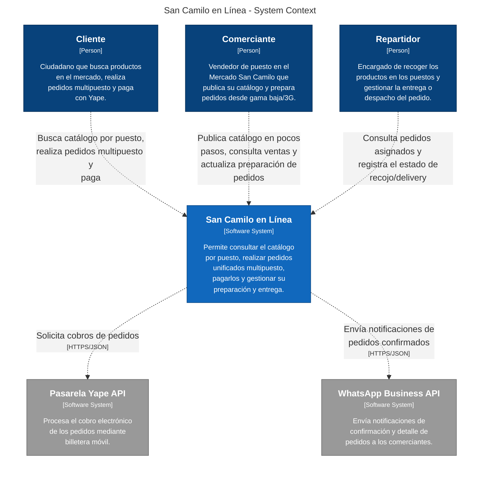

# San Camilo en Línea - Laboratorio 04: Fundamentos de Arquitectura de Software

**Curso:** Construcción de Software (EPIS-UNSA)  
**Semestre:** 2026-B  
**Grupo:** Grupo 07  

## Integrantes
* **Jhon Deyvis Cuyo Ccapa:** Creador principal de diagramas como código (Mermaid, PlantUML, Python) y redactor de ADRs.
* **Wilber Jesus Guerra Pilco:** Verificador de propuestas de IA, encargado de la bitácora de IA y revisor de Pull Requests.
* **Diego Sebastian Santacruz Villa:** Encargado de la estructura del proyecto, documentación de drivers y redactor de la reflexión grupal.

## Caso 7: San Camilo en Línea
Plataforma web y móvil diseñada para canalizar los pedidos a los puestos del Mercado San Camilo de Arequipa, permitiendo opciones de recojo o delivery. Los clientes pueden explorar catálogos agrupados por puesto, realizar pedidos multi-puesto y pagar mediante Yape. Las confirmaciones de compra se notifican automáticamente al comerciante vía WhatsApp API.

* **Atributo de Calidad Crítico:** Usabilidad / Capacidad de interacción (QA-01). Un comerciante con poca experiencia digital debe poder publicar un producto en su catálogo en $\le 3$ toques desde un smartphone de gama baja en red 3G.

## Estructura del proyecto
```
cs-2026b-lab04-grupo07/
├── README.md                          # (Informe principal con el Mermaid embebido)
├── docs/
│   ├── cuestionario.md                # (Respuestas a la Sección IV)
│   └── architecture/
│       ├── drivers.md                 # (E1: Requisitos, Atributos y Escenarios)
│       ├── matriz-decision.md         # (E2: Matriz ponderada de 3 estilos)
│       ├── bitacora-ia.md             # (E7: Prompts y verificaciones)
│       ├── adr/
│       │   ├── 000-plantilla.md
│       │   ├── 001-estilo-arquitectonico.md
│       │   ├── 002-base-de-datos.md
│       │   └── 003-pwa-vs-nativa.md
│       └── diagramas/
│           ├── arquitectura.mmd       # (E3: Mermaid)
│           ├── alternativa.puml       # (E5: PlantUML descartada)
│           └── despliegue.py          # (E6: Python Diagrams)
└── img/                               # (Imágenes PNG generadas)
    ├── arquitectura.png
    ├── alternativa.png
    └── despliegue.png
```

## Arquitectura Elegida (Monolito Modular)



## Registros de Decisiones Arquitectónicas (ADRs)
* [ADR-001: Estilo Arquitectónico - Monolito Modular](docs/architecture/adr/001-estilo-arquitectonico.md)
* [ADR-002: Selección de Base de Datos - PostgreSQL con Esquemas Aislados](docs/architecture/adr/002-base-de-datos.md)
* [ADR-003: Estrategia de Cliente Móvil - Progressive Web App (PWA)](docs/architecture/adr/003-pwa-vs-nativa.md)

## Documentación Adicional
* [Drivers Arquitectónicos y Escenarios de Calidad](docs/architecture/drivers.md)
* [Matriz de Decisión Ponderada](docs/architecture/matriz-decision.md)
* [Bitácora de Uso de Inteligencia Artificial](docs/architecture/bitacora-ia.md)

## Reflexión sobre el Uso de la IA
El uso de asistentes de IA facilitó la exploración inicial de patrones y la aceleración en la sintaxis de diagramas como código (Mermaid y PlantUML). Sin embargo, identificamos que la IA tiende a sesgarse hacia arquitecturas complejas de moda (como Microservicios y Kubernetes), las cuales sobrepasan nuestras restricciones de 1 mes de plazo, equipo de 3 integrantes y despliegue en un único VPS económico. Aprendimos que la IA debe utilizarse únicamente como herramienta de soporte para acelerar la redacción y generación de borradores, mientras que el análisis crítico, la verificación de factibilidad real y la toma final de decisiones son responsabilidad absoluta del equipo humano.

## Diseño UML (Lab 05) - San Camilo en Línea

En esta sección se presenta el diseño detallado orientado a objetos para el sistema **San Camilo en Línea** (Caso 7), en coherencia con la arquitectura del `ADR-001` (monolito modular con puertos y adaptadores).

### 1. Historia de Usuario y Criterios de Aceptación
* Documento de la [Historia de Usuario HU-07](docs/design/historia.md) con sus criterios de aceptación en formato *Dado / Cuando / Entonces*.

### 2. Diagrama de Clases (E1)
Representa las entidades, objetos de valor, interfaces (puertos), adaptadores y servicios del dominio del módulo de Pedidos y Pagos.


### 3. Diagrama de Secuencia (E2)
Flujo dinámico del escenario principal para la confirmación de un pedido multipuesto y pago único con Yape.


### 4. Máquina de Estados (E3)
Ciclo de vida de la entidad `PedidoPuesto`:



### 5. Diagrama de Actividades (E4)
Proceso de negocio completo para la preparación, recojo y consolidación del pedido multipuesto en el mercado San Camilo.


### 6. Diagrama de Paquetes (E5)
Estructura modular del sistema y regla de dependencias unidireccionales sin acoplamiento cíclico (Regla C4).


### 7. Ingeniería Inversa y Round-Trip (E6)
* [Código Fuente Esqueleto en Python](src/pedidos/dominio.py)
* [Análisis de Diferencias y Mitigación Round-Trip](docs/design/round-trip.md)
* Diagrama de clases derivado del código:


### 8. Consistencia (C1-C5) y Bitácora de IA (E7)
* [Informe de Auditoría de Consistencia (Reglas C1-C5)](docs/design/consistencia.md)
* [Bitácora de Interacciones con la IA Generativa](docs/design/bitacora-ia.md)

---

## Arquitectura C4 (Lab 06) — San Camilo en Línea

Modelado de arquitectura como código elaborado con **Structurizr DSL** (`docs/architecture/c4/workspace.dsl`), coherente con las decisiones del **ADR-001 (Monolito Modular)** del Laboratorio 04 y el **Diseño UML** del Laboratorio 05.

### Nivel 1: Diagrama de Contexto en Mermaid



### Vistas Exportadas del Modelo C4 (`workspace.dsl`)

1. **Nivel 1 — Contexto del Sistema:** [Ver imagen PNG](docs/architecture/c4/img/structurizr-Contexto.png) | [Ver Contexto escrito a mano](docs/architecture/c4/img/contexto-manual.png)
2. **Nivel 2 — Contenedores:** [Ver imagen PNG](docs/architecture/c4/img/structurizr-Contenedores.png)
3. **Nivel 3 — Componentes (Backend API):** [Ver imagen PNG](docs/architecture/c4/img/structurizr-Componentes.png)
4. **Nivel 4 — Código (Clases UML del Lab 05):** [Ver diagrama de clases UML](docs/design/clases.puml)
5. **Vista Complementaria — Dinámica (Confirmar y Pagar):** [Ver imagen PNG](docs/architecture/c4/img/structurizr-ConfirmarYPagar.png)
6. **Vista Complementaria — Despliegue (Producción):** [Ver imagen PNG](docs/architecture/c4/img/structurizr-Despliegue.png)

### Documentación del Laboratorio 06
* [Inventario de elementos C4 (`inventario.md`)](docs/architecture/c4/inventario.md)
* [Modelo fuente en Structurizr DSL (`workspace.dsl`)](docs/architecture/c4/workspace.dsl)
* [Comparación de herramientas y vistas (`comparacion.md`)](docs/architecture/c4/comparacion.md)
* [Lista de revisión oficial y auditoría IA (`revision-c4.md`)](docs/architecture/c4/revision-c4.md)
* [Explicación para público no técnico (`explicacion.md`)](docs/architecture/c4/explicacion.md)
* [Bitácora de uso de IA (`bitacora-ia.md`)](docs/architecture/c4/bitacora-ia.md)

---
