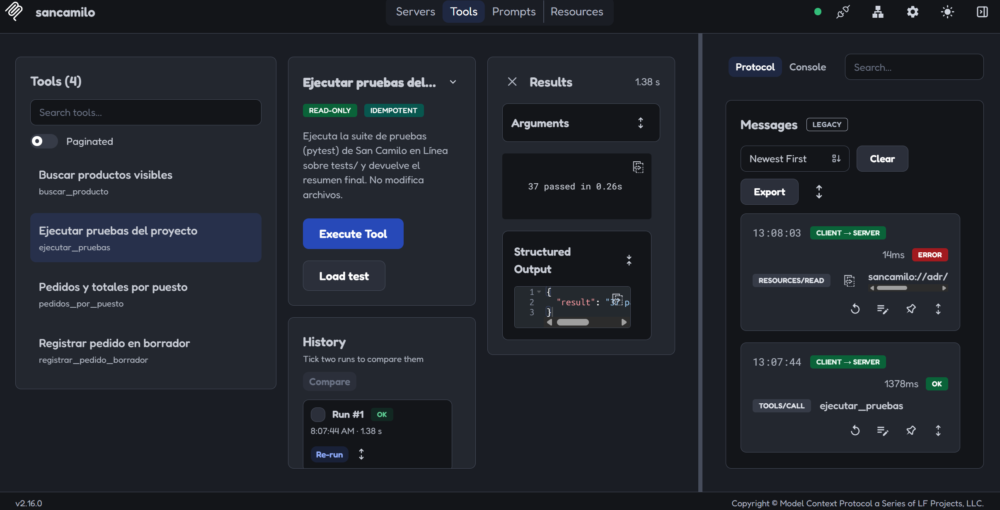
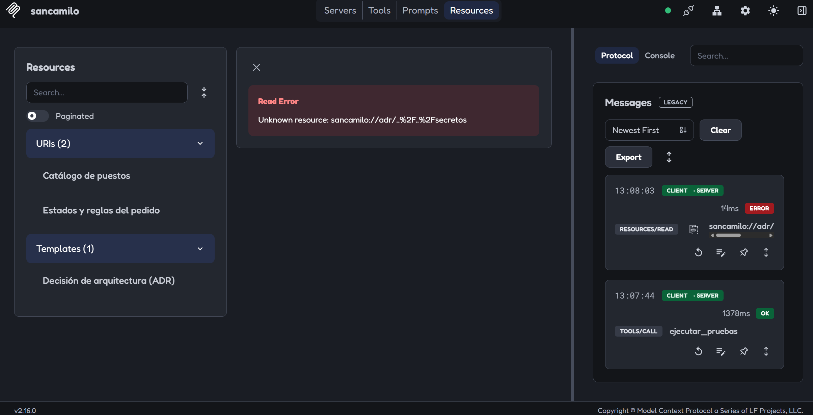
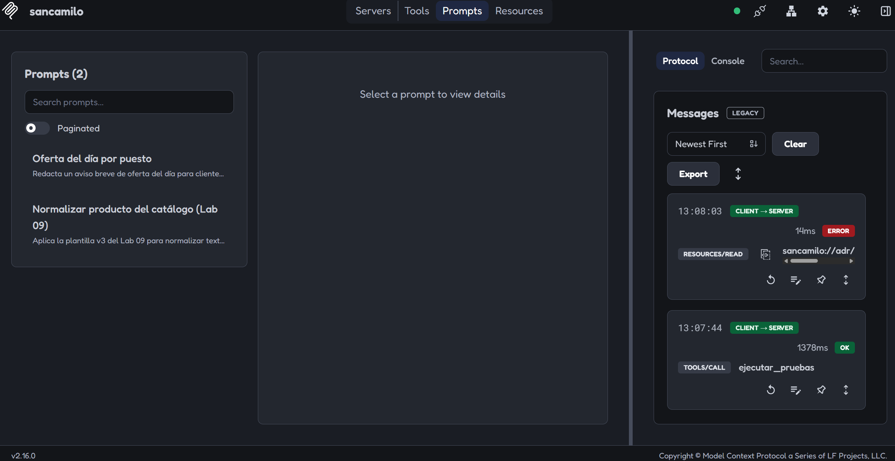
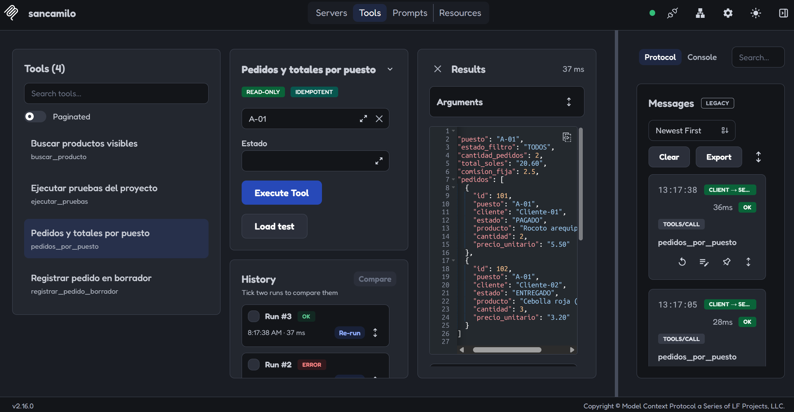
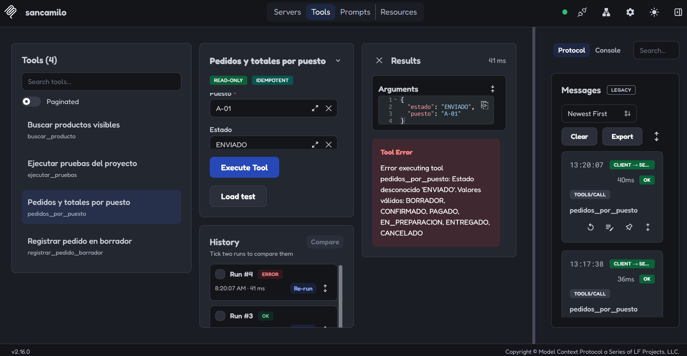
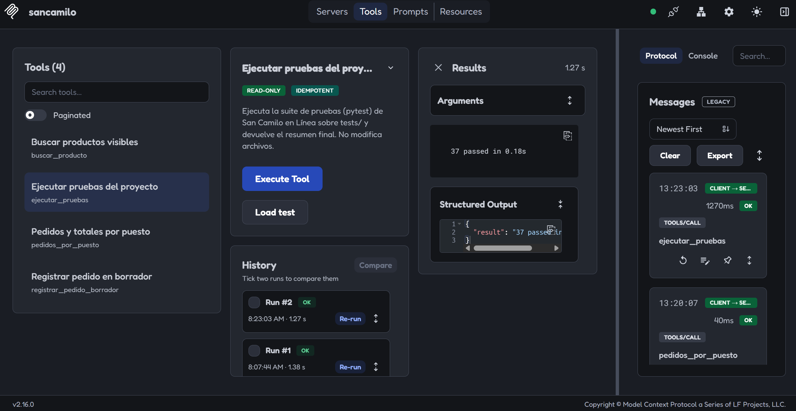

# Evidencias de Verificación con MCP Inspector — San Camilo en Línea (E3)

**Comandos ejecutados en Windows PowerShell:**
```powershell
nvm install 24.22.3
nvm use 24.22.3
node --version
npm --version

.\.venv\Scripts\Activate.ps1
python -m pytest -q agentes/mcp/pruebas/test_servidor_mcp.py

npx @modelcontextprotocol/inspector `
  ".\.venv\Scripts\python.exe" `
  "agentes\mcp\servidor_mcp\sancamilo_mcp.py"
```

&nbsp;

## Capturas que se deben adjuntar

Las herramientas, los recursos y los prompts aparecen en pestañas distintas del Inspector. Por eso se necesitan capturas separadas para demostrar el catálogo completo.

### 1. Herramientas

En la pestaña **Tools**, mostrar las cuatro herramientas y el estado conectado del servidor:



Debe verse `Tools (4)` y los nombres `buscar_producto`, `pedidos_por_puesto`, `ejecutar_pruebas` y `registrar_pedido_borrador`.

### 2. Recursos

En la pestaña **Resources**, mostrar los dos URI y la plantilla ADR:



Debe verse `URIs (2)` y `Templates (1)`, con `sancamilo://catalogo/puestos`, `sancamilo://pedidos/estados` y `sancamilo://adr/{numero}`.

### 3. Prompts

En la pestaña **Prompts**, mostrar ambos prompts disponibles:



Debe verse `oferta_del_dia` y `normalizar_catalogo_producto`.

### 4. Llamada correcta (`pedidos_por_puesto`)



Ejecutar con `{"puesto": "A-01"}`. La captura debe mostrar el resultado estructurado con `cantidad_pedidos: 2`, `total_soles: "20.60"`, `comision_fija: 2.5` y estado exitoso.

### 5. Error de validación



Ejecutar `pedidos_por_puesto` con `{"puesto": "A-01", "estado": "ENVIADO"}`. Debe verse `isError: true` y el mensaje con los estados válidos. La prueba `test_09_recurso_adr_acepta_010_y_rechaza_path_traversal` verifica además el rechazo del URI de ADR manipulado.

### 6. Ejecución de pruebas desde el MCP Inspector

Seleccionar la herramienta `ejecutar_pruebas`, presionar **Execute Tool** y capturar el resultado:



Resultado verificado en esta ejecución: `37 passed in 0.26s`.


