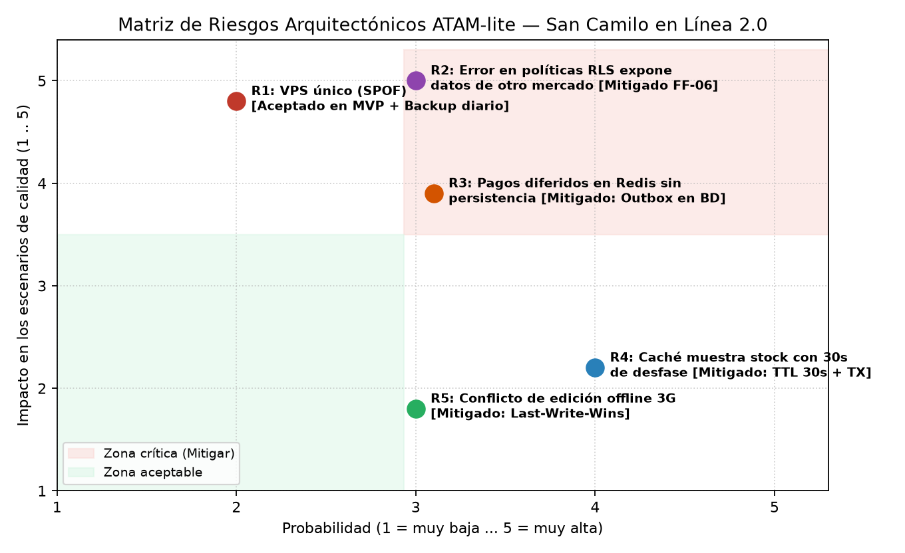

# Evaluación Arquitectónica ATAM-lite y Gestión de Riesgos — San Camilo en Línea 2.0

## 1. Hallazgos de la Evaluación ATAM-lite (Evaluación Cruzada + Evaluador Adversario IA)

| Tipo de Hallazgo | Escenario Afectado | Descripción del Hallazgo | Respuesta y Verificación del Equipo (Con Evidencia) |
| :--- | :---: | :--- | :--- |
| **Punto de Sensibilidad 1** | `QA-03` (Rendimiento 18 req/s) | El `p95` de consulta del catálogo es altamente sensible a la tasa de aciertos (*hit rate*) si se usa únicamente caché en Redis sin optimizar la consulta SQL subyacente. | **Confirmado con simulación (`fitness/rendimiento.py`):** Con *solo caché*, cuando el hit rate cae por debajo del 20% (ej. caché fría tras reinicio), el `p95` se dispara por encima de 3500 ms. Al combinar **Índice compuesto `(mercado_id, puesto_id)` + Caché**, el `p95` se mantiene en **184 ms** incluso con 0% de caché. |
| **Punto de Sensibilidad 2** | `QA-04` (Disponibilidad pagos) | El tiempo de detección del `Circuit Breaker` depende del umbral de fallas consecutivas (`umbral=3`) y de la ventana de espera (`espera_s=120`). | **Confirmado con simulación (`fitness/disponibilidad.py`):** Con `umbral=3`, durante una caída de 20 minutos de Yape las llamadas inútiles al proveedor caen de **180 a solo 18**, protegiendo los workers de la API. |
| **Punto de Trade-off 1** | `QA-03` vs. Exactitud de Stock | Cachear el catálogo de puestos en Redis (TTL 30 s) reduce la latencia `p95` a **115 ms** (**Rendimiento**), pero un cliente podría ver como disponible un producto que se agotó hace 10 segundos (**Consistencia**). | **Aceptado y mitigado (`ADR-006`):** Se usa un TTL corto (30 s) para lecturas de catálogo y se valida el stock real de forma transaccional (`SELECT ... FOR UPDATE`) dentro de `Módulo Pedidos` al momento de confirmar el pedido. |
| **Punto de Trade-off 2** | `QA-04` vs. Inmediatez de Pago | Diferir pagos en una tabla `outbox` cuando el circuito se abre garantiza **0 pedidos perdidos** (**Disponibilidad**), pero la confirmación final del cobro y el aviso de WhatsApp al comerciante pasan a ser asíncronos (**Consistencia Eventual**). | **Aceptado (`ADR-007`):** Es preferible capturar el pedido multipuesto y procesarlo apenas Yape responda que rechazar la compra del cliente. |
| **Riesgo R1** *(Prob: 2, Imp: 5)* | `QA-03`, `QA-04` | **VPS único como Punto Único de Falla (SPOF):** Una caída del servidor físico deja inoperativos los 3 mercados simultáneamente. | **Aceptado para el MVP de 1 mes (`R-03`):** El presupuesto restringe el despliegue a un único VPS. Se mitiga operativamente con snapshots diarios automatizados y script de restauración en $< 45$ min. |
| **Riesgo R2** *(Prob: 3, Imp: 5)* | `QA-01` (Aislamiento) | **Mala configuración o desactivación accidental de políticas RLS en PostgreSQL** que exponga pedidos de San Camilo a comerciantes de Altiplano o Río Seco. | **Mitigado en Iteración 1 y E5 (`test_ff06_aislamiento_multimercado_rls`):** Se creó una *fitness function* automatizada en CI que simula consultas cruzadas entre mercados y bloquea el PR si se filtra 1 sola fila. |
| **Riesgo R3** *(Prob: 3, Imp: 4)* | `QA-04` (Disponibilidad) | **Pérdida de pagos diferidos si se encolan solo en memoria (Redis)** y el contenedor se reinicia. | **Mitigado en Iteración 3 (`ADR-007`):** Se rechazó la propuesta de la IA de guardar pagos pendientes en Redis; se persisten en una tabla transaccional `outbox_pagos` en PostgreSQL. |
| **Riesgo R4** *(Prob: 4, Imp: 2)* | `QA-03` (Rendimiento) | **Stock o precio desactualizado durante ventana de 30 s de la caché** en hora punta. | **Mitigado:** Invalidación explícita de la clave Redis del puesto cuando el comerciante actualiza su producto + verificación de stock al confirmar pedido. |
| **Riesgo R5** *(Prob: 3, Imp: 2)* | `QA-05` (Offline-first 3G) | **Conflicto de sincronización** si dos personas del mismo puesto editan el precio del mismo producto sin señal 3G. | **Mitigado:** Política *Last-Write-Wins (LWW)* con marca de tiempo del servidor y notificación en pantalla al comerciante. |
| **Falso Positivo de la IA (Refutado)** | `QA-04` | *"El worker de Celery en el mismo VPS colapsará la CPU al procesar los mensajes de los 3 mercados."* | **Refutado con números:** 1800 pedidos en 10 horas equivalen a **3 pedidos por minuto (0,05 pedidos/s)**. Procesar 3 tareas asíncronas por minuto consume $< 1\%$ de CPU en 1 vCPU. |
| **No Riesgo** | `QA-03` | **Mantener el estilo de Monolito Modular (`ADR-001`) para los 3 mercados.** | **Respaldado por simulación:** Con índice compuesto y caché, 4 workers en el monolito soportan 18 req/s con `p95 = 115 ms` (muy por debajo del límite de 1500 ms). |

---

## 2. Matriz de Probabilidad e Impacto y Mitigación de Riesgos en Zona Crítica (E7)

| ID | Riesgo Identificado | Probabilidad (1–5) | Impacto (1–5) | Severidad ($P \times I$) | Zona | Decisión: Mitigación Implementada o Razón de Aceptación |
| :---: | :--- | :---: | :---: | :---: | :---: | :--- |
| **R2** | Error u omisión en políticas **Row-Level Security (RLS)** expone pedidos o ventas de San Camilo a usuarios de Altiplano o Río Seco (`QA-01`). | 3 | 5 | **15** | **Crítica** | **Mitigado (`ADR-008` + `FF-06`):** Se implementó el filtro obligatorio por `mercado_id` y la fitness function `test_ff06_aislamiento_multimercado_rls_y_alta_sin_codigo` que se ejecuta en cada PR en GitHub Actions. |
| **R3** | Pérdida de cobros diferidos durante una caída de Yape si la cola de pendientes se guarda en Redis sin persistencia (`QA-04`). | 3 | 4 | **12** | **Crítica** | **Mitigado (`ADR-007`):** Se descartó Redis para pagos diferidos y se adoptó una tabla transaccional `outbox_pagos` en PostgreSQL procesada por el worker Celery. |
| **R1** | El servidor **VPS único** (`R-03`) actúa como Punto Único de Falla (SPOF) ante una caída de hardware del proveedor cloud. | 2 | 5 | **10** | **Media-Alta** | **Aceptado para el MVP de 1 mes:** Contratar un clúster multi-nodo en alta disponibilidad excede el presupuesto `R-03`. Se mitiga con backups automáticos diarios en almacenamiento externo y script de recreación con Docker Compose en $< 45\text{ min}$. |
| **R4** | La caché de catálogo en Redis (TTL 30 s) muestra stock desactualizado durante picos de compra (`QA-03`). | 4 | 2 | **8** | **Aceptable** | **Mitigado (`ADR-006`):** El TTL se limita a 30 segundos y la reserva de stock se verifica transaccionalmente en PostgreSQL dentro de `Módulo Pedidos` antes de invocar el cobro. |
| **R5** | Dos comerciantes del mismo puesto editan precios sin señal 3G y generan conflicto al reconectar (`QA-05`). | 3 | 2 | **6** | **Aceptable** | **Mitigado (`ADR-007`):** Resolución determinista *Last-Write-Wins (LWW)* con timestamp y aviso visual en la PWA. |